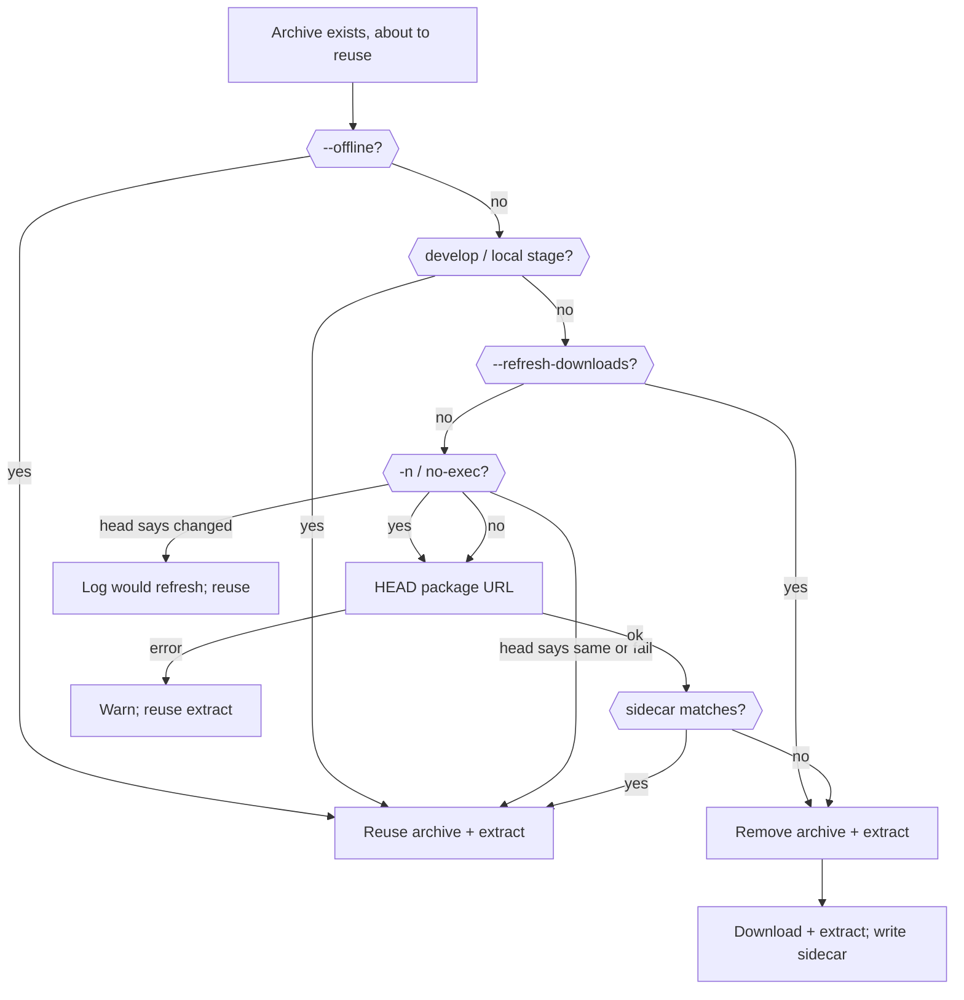

# Plan: online conditional freshness for GitLab package downloads

- **Status:** in progress
- **Related:** [`package-download-refresh.md`](../archive/package-download-refresh.md) (force `--refresh-downloads`, deferred `pkg-dl-refresh-conditional`); [#296](https://github.com/ja11sop/cuppa/issues/296); [`unverified-latest.md`](unverified-latest.md) (warn-and-reuse when a check cannot run); [`terse-dependency-locations.md`](../archive/terse-dependency-locations.md) (durable resolve children); `GitlabPackageDependency` in [`gitlab.py`](../../cuppa/package_managers/gitlab.py); [`ROADMAP.md`](../../ROADMAP.md) — storage `package-download-freshness`
- **Updated:** 2026-11-01
- **Impact:** `minor` (online consume may re-fetch after a same-version registry overwrite without a new flag)

## Problem

GitLab package consume keys the cache by **package + version + stem**. Archive
exists → skip download. Extract `include/` exists → skip extract. There is no
registry freshness check on the online path.

That is correct when a version string is immutable. It is wrong when the
registry **overwrites the same version**:

| Case | What happens today |
|------|--------------------|
| Floating tag retag (`develop`, and any other same-name overwrite) | Local archive and extract stay forever until purge / `--refresh-downloads` |
| Semver same-version republish (protobuf / Abseil soak that motivated [#296](https://github.com/ja11sop/cuppa/issues/296)) | Same sticky cache |
| `version="latest"` when the tip **version string** moves | New path → natural miss. Retag of the *concrete* pin is still sticky |

`--refresh-downloads` (shipped in 1.11.0) is the force tool. Package CI that
consumes registry deps should keep using it until this plan lands. It should
not be the only way an ordinary online configure stays current.

**Soak that reopened this:** corosio pinned `capy` at `develop`. The registry
file was retagged with current headers (`results.hpp`). A local / sticky-runner
cache still had the September archive. Configure logged `Using package
[capy/develop/rel] from [...]` and never contacted the registry. Build failed
on a missing header. After `--refresh-downloads=capy` (or a wiped cache) the
same branch built cleanly.

## Intent

On an **online** configure, when a cached GitLab package archive is about to be
reused, cheaply ask the registry whether that archive file is still the one
published for that URL. If it changed, drop cache and download + extract as
today. If it matches, reuse. No new flag for the happy path.

This is the deferred `pkg-dl-refresh-conditional` slice from
[`package-download-refresh.md`](../archive/package-download-refresh.md), scoped
as the normal online policy rather than an opt-in.

## Current behaviour (authoritative)

From `GitlabPackageDependency` construction (unchanged until this lands):

1. Resolve preferred/existing archive under `downloads_root/packages/...`.
2. If `--refresh-downloads` applies → drop archive + extract, then fetch.
3. Else if not `--offline` and archive missing → download.
4. Else if extract `include/` missing and archive present → extract.
5. Else → `Using package [...] from [...]` (reuse as-is). **No HEAD.**

`--develop` / local publisher stage still skip download entirely.

## Settled decisions

| Topic | Decision |
|-------|----------|
| Default online | Conditional check before reuse when an archive already exists |
| Check mechanism | `HEAD` on the generic package file URL (same URL download would use) |
| Identity | Prefer GitLab `X-Checksum-Sha256` when present; else `Last-Modified` + `Content-Length`. Store the chosen identity in a **sidecar next to the archive** (written after a successful download). Missing sidecar → treat as stale once (re-fetch and write sidecar) |
| Match | Reuse archive + extract; keep today's `Using package` log (debug may note up-to-date) |
| Mismatch / 404 on HEAD | Remove archive + extract for that selection; download + extract as today |
| HEAD / network / auth failure | **Warn once and reuse** the existing extract when present (same spirit as [`unverified-latest.md`](unverified-latest.md)). Do not hard-fail consume. Do not update the sidecar |
| `--offline` | No HEAD. Existence-only reuse (today) |
| `--refresh-downloads` | Still force drop + fetch. No conditional short-circuit |
| `--develop` / local stage | Unchanged. No registry check |
| Scope of versions | **All** GitLab package version keys — do **not** special-case `develop` or a hand list of “floating” names. There is no reliable registry signal that a version string is mutable, and same-version semver overwrite (#296) must stay covered. Prefer cheaper HEAD / timeouts later if volume hurts — not a name heuristic |
| New CLI flag | **None** for the default conditional path |
| `payload_sha256` in `cuppa-publish.json` | Not the first check. Cascade tip overlay stays as today. Optional later: verify after extract; not required for v1 |
| Content-addressed archive filenames | Out of scope (larger change; would also fix the pain) |
| Location / Conan archives | Out of scope (same as force refresh) |
| `-n` / `--no-exec` | Perform the HEAD (read-only) but do not delete or re-download; log what would refresh |
| Package CI | May keep `--refresh-downloads` until this soaks; may drop it afterward. Not required by this plan |
| Terse durable lines | **No** new action kind and **no** durable line when HEAD says the archive matches (stay quiet). A stale archive that re-fetches uses the existing `[collect]` / `[extract]` children. HEAD failure that warns and reuses: one durable `[collect]` child with `status=warn` and a remark (same pattern as unverified-latest — keep the badge, put the fact in the remark). No second end-of-build line |

## Work slices

| ID | Deliverable | Target |
|----|-------------|--------|
| `pkg-dl-fresh-plan` | This plan + ROADMAP / design index | **Done** (on this branch) |
| `pkg-dl-fresh-sidecar` | Sidecar format + read/write next to archive after download | **Done** — `package_download_freshness.py` |
| `pkg-dl-fresh-head` | HEAD helper (auth headers, checksum / L-M+length parse) | **Done** — reuses `http_head`; identity from headers |
| `pkg-dl-fresh-hook` | Hook in `GitlabPackageDependency` before reuse; unit tests for match / mismatch / HEAD fail / offline / force / dry-run | **Done** — `tests/unit/test_package_download_freshness.py` |
| `pkg-dl-fresh-docs` | Antora Managing / Using + CHANGELOG; note CI may drop bare `--refresh-downloads` after | **Done** (on this branch) |

## Acceptance

1. Retag `develop` (or any same-version overwrite) on the registry; next online
   configure without `--refresh-downloads` re-fetches and the extract matches the
   new archive.
2. Unchanged registry file → one HEAD, no re-download, extract reused.
3. Online, HEAD fails, extract present → warn once, build continues on the
   remembered extract.
4. `--offline` never HEADs.
5. `--refresh-downloads` still force-refetches.
6. Antora states that online consume checks archive freshness; force refresh
   remains available.

## Out of scope

- Always force-refreshing every configure.
- A new `--refresh-package-dependencies` spelling.
- Auto-GC of old extracts.
- Changing publish policy (whether repos pin semver vs `develop` vs `latest`).
- Making `develop` mean cuppa `--develop` (different feature).
- Location HTTP archive freshness.
